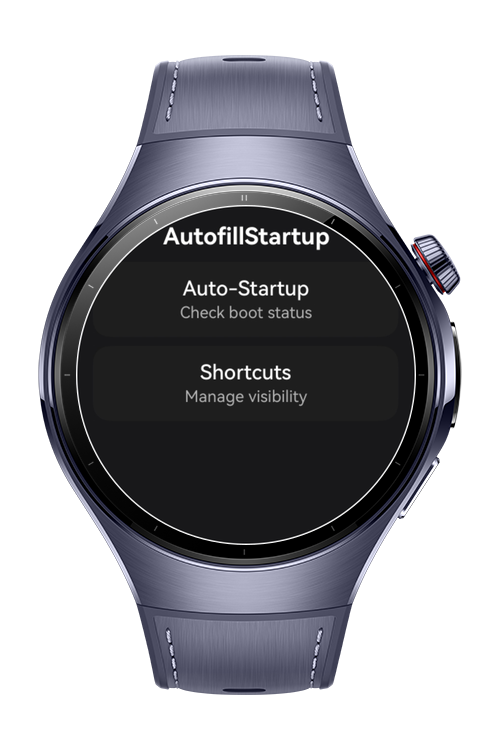
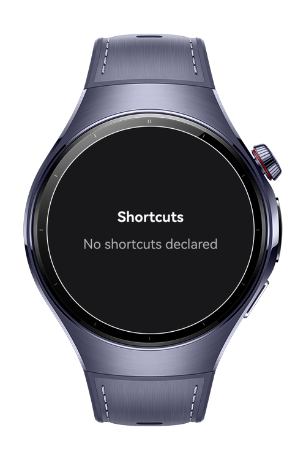
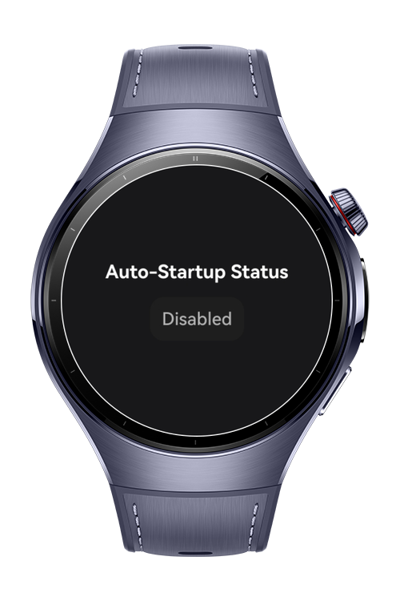

> **Note:** To access all shared projects, get information about environment setup, and view other guides, please visit [Explore-In-HMOS Index](https://github.com/Explore-In-HMOS/hmos-index).

# How to Build Autofill Startup

A wearable "Quick Access" panel for the Huawei Watch 5 that demonstrates two self-contained, permission-free HarmonyOS APIs checking whether an app is registered for automatic startup, and reading/toggling the visibility of an app's own home-screen shortcuts.

# Preview

<div>
  
  
  
</div>

# Use Cases

- **Quick access menu** — A round-screen entry menu (`List`) linking to two feature pages via `Navigation`/`NavPathStack`, the standard multi-page pattern for a single-window wearable app.
- **Auto-startup status check** — On page appear, calls `autoStartupManager.getAutoStartupStatusForSelf()` and renders whether the app is currently enabled for automatic startup. This is a read-only check; there is no public API for a third-party app to register itself for boot or trigger-based auto-start.
- **Shortcut visibility management** — On page appear, calls `shortcutManager.getAllShortcutInfoForSelf()` to read the app's own statically declared shortcut, then an `ArcButton` calls `setShortcutVisibleForSelf()` to toggle its visibility.

# Technology

## Stack
- **Language**: ArkTS
- **UI Framework**: ArkUI (Stage Model)
- **Tools**: DevEco Studio 5.1.0 or later
- **Libraries & Kits**:
    - `@kit.AbilityKit` — `autoStartupManager.getAutoStartupStatusForSelf()`, `shortcutManager.getAllShortcutInfoForSelf()` / `setShortcutVisibleForSelf()`
    - `@kit.ArkUI` — `ArcButton`, `ArcButtonOptions`, `ArcButtonPosition`, `ArcButtonStyleMode`, `NavPathStack`
    - `@kit.BasicServicesKit` — `BusinessError`
    - `@kit.PerformanceAnalysisKit` — `hilog`

## Required Permissions
 - None

# Directory Structure

```
how-to-build-auto-fill-startup/
├── AppScope/
│   ├── app.json5
│   └── resources/base/
│       ├── element/string.json        # app_name
│       └── media/icon.png
└── entry/
    ├── build-profile.json5
    └── src/main/
        ├── module.json5               # deviceTypes: wearable, static shortcut metadata
        ├── ets/
        │   ├── constants/
        │   │   └── Constants.ets      # RouteNames, hilog domain/tag, shortcut id
        │   ├── entryability/
        │   │   └── EntryAbility.ets   # loads pages/Index
        │   └── pages/
        │       ├── Index.ets              # Navigation host, quick-access menu
        │       ├── StartupStatusPage.ets  # autoStartupManager demo
        │       └── ShortcutsPage.ets      # shortcutManager demo
        └── resources/base/
            ├── element/
            │   ├── color.json
            │   ├── float.json
            │   └── string.json
            ├── media/icon.png
            └── profile/
                ├── main_pages.json
                └── shortcuts_config.json  # declares the "quick_checkin" static shortcut
```

# Constraints and Restrictions

## Supported Device
- Huawei Watch 5

## Minimum API Version

| API | Min version |
|---|---|
| `autoStartupManager.getAutoStartupStatusForSelf()` | API 21 |
| `shortcutManager` (`getAllShortcutInfoForSelf`, `setShortcutVisibleForSelf`) | API 20 |

### `autoStartupManager` — Read-Only by Design
`getAutoStartupStatusForSelf()` only reports the current status; there is no companion "set"/"register" API in the current SDK for a third-party app to enroll itself for boot-time or trigger-based (charging, Bluetooth) auto-start. If your app has never been registered elsewhere, expect this page to correctly show **Disabled** — that is the accurate result, not a bug.

### Static Shortcuts Require a Clean Install
Static shortcut config (`shortcuts_config.json`, referenced via `module.json5` → `metadata` → `ohos.ability.shortcuts`) is parsed by the bundle manager at install time. If you add or change the shortcut config after the app is already installed, a hot-reload/re-run will often **not** pick up the change — fully uninstall the app from the device, then reinstall, before testing `getAllShortcutInfoForSelf()`.

# License

**How to Build Autofill Startup** is distributed under the terms of the MIT License.
See the [LICENSE](./LICENSE) for more information.